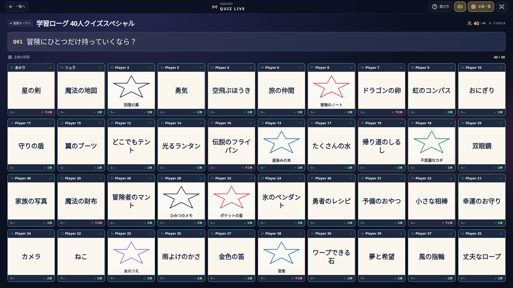

# みんなでクイズ

タイトル画面の **問題 → みんなでクイズ → ホスト部屋を作成** から開始します。回答者は最大40人、司会1人、上映画面4台までです。参加者側のアカウント・学年・単元選択は不要です。

## 司会と参加者

1. 番組名とルールを選んで部屋を作ります。モードに合うバラエティのお題が用意されています。
2. 「問題を作る・編集」で自由に出題文、正解、別表記、回答方法、制限時間、得点を設定できます。JSONで問題セットの保存・読込もできます。司会の進行カード上部にある「学習の単元から出題」では既存の単元・配信課題から6・12・30問を取り込みます。問題と正解は司会側だけに保持されます。
3. 出題は順番／ランダムから選び、問題数を指定できます。選択式の正答位置は、問題ごとに全員共通のランダム配置にできます。
4. URLまたはローカル生成のQRコードを共有します。参加者は名前（20文字まで）を入力して直接参加します。同じブラウザの再接続は席・提出済み回答・得点を引き継ぎます。
5. 自動進行ONでは「番組をスタート」から2秒後に出題します。手動進行では「出題スタート！」で開始します。問題とカウントダウンを表示し、全員から回答を受け付けます。途中の一時停止と10秒延長に対応します。
6. 学習の選択式問題では、締切操作・時間切れのどちらでも、正解と全参加者の回答・正誤（未回答を含む）を自動公開します。判定は選択した正解の文字列との一致で行います。自由入力・手書きの問題では、司会が回答を締め切り、各カードの「公開」で1人ずつ、または「全員の回答を公開」で一斉に見せます。基本は「全員の回答・正誤を表示」で正解を含めて一括公開します。1人ずつの公開も選べます。
7. 自由入力と手書きは受付中から司会が○／×をチェックします。選択式は提出と同時にホスト側で自動判定します。テキストの自動照合は司会の補助ボタンから利用できます。全角・半角、英字大小、ひらがな・カタカナ、空白などを正規化します。手書きの内容はOCRで判定しません。未判定の手書き・自由入力は順位発表を止め、採点漏れを防ぎます。
8. 得点・ランキングを発表して次へ進みます。採点の修正は同じ問題の差分だけを反映するので、二重加点・ライフの二重減少はありません。参加者別の±10点調整、部隊ではなくクイズのチーム分けにも対応します。

手書きは指・マウス・ペンに対応し、色・太さ・消しゴム・一画戻す・全消しを使えます。提出後の変更はできません。締切や提出の可否はホスト／サーバーが判定し、端末の時計を変えても延長できません。

## テレビ・プロジェクター

招待欄の「テレビ・プロジェクター用の画面を開く」を使います。司会画面には問題の正解・役職があるため、会場では専用の上映画面を投影します。

司会の **「40人の回答を一画面に上映」** で全員一覧に切り替えます。1920×1080では10列×4段、1280×720では8列×5段など、実際の画面高に合わせて40フリップを収めます。スマホからも一覧を選べます。切替で回答が自動公開されることはありません。

通常の司会端末方式は司会の画面を開いたまま使います。端末の画面録画や外部通話アプリと組み合わせられます。アプリ内のマイク収録・通話・外部配信は行いません。

## 10種類のルール

| ルール | 判定・得点 |
| --- | --- |
| 全員フリップ | 全員がテキスト・選択式・手書きで回答。正解者に問題ごとの得点。 |
| 早押しバトル | ホスト到着順の最初の人だけが回答。不正解と判定すると他の人に回答権が開く。同じ人は再挑戦不可。 |
| ライフサバイバル | 3ライフで開始。不正解・未回答で1減少、0は観戦。最後の1人で終了し、残りライフ優先で順位付け。 |
| チーム対抗 | 2〜8チーム。個人得点をチーム単位で合計。均等振分・手動調整が可能。 |
| 全員一致チャレンジ | 2人以上の全員の回答が一致すると全員加点。絵や意味の一致は司会が手動指定。 |
| 多数派はどっち？ | 最大の一致グループに加点。同数最大は両方加点、単独回答だけの場合は得点なし。絵は司会がグループを判定。 |
| 数値ニアピン | 提出された数値の平均がベストアンサー。平均からの距離が近い順に設定得点の100%・70%・50%・20%。等距離は同順位。未回答は平均に入れず得点なし。全角・半角に対応。 |
| お絵かきクイズ | 順番に1人が秘密のお題を描画。ほかの人はテキストで当てる。正解者に満点、描き手には半分のボーナス。 |
| 大喜利・投票 | 回答を公開後、1人1票。自分以外に投票でき、1票で10点。締切までは投票先の変更可。 |
| 一致の人狼 | 全員一致と役職推理を組み合わせた3〜40人用モード。以下の専用進行を使用。 |

番組内の得点はこの番組のスコアです。司会による任意の採点で学習ポイントを発行することはありません。

## 一致の人狼

問題はセット末尾で循環し、決着まで続きます。累計10回の全員一致、または狼が全員人間に戻れば人間側の勝利。活動人数の半数以上が狼になると狼側の勝利です。

5問ごとに審議するかを投票し、1人でも希望すれば怪しい人／スキップを投票します。スキップが最多（同票含む）なら夜も省略し、人同士の最多同票なら誰も退治せず夜へ進みます。未投票はスキップとして集計します。

夜は狼が襲撃先、預言者が調査先、狩人が護衛先を秘密に選びます。狼の最多同票は抽選。護衛は自分・直前の夜と同じ相手を選べません。未選択の能力は使われません。霊媒師には審議で退治された人が狼だったかが届きます。狂人は狼側ですが調査では人間判定で、狼と互いの正体を知りません。

退治・襲撃された人は役職を失って人間になり、回答と審議を続けます。活動人数の分母には含めません。この実装では人間に戻った人も昼の投票に参加できます。司会が各集計を確定するまで投票先を変更できます。

3〜15人の役職配分は参照表に従います。16〜40人は独自の拡張として狼を `floor(人数 / 4)` 人、預言者・霊媒師・狩人・狂人を各1人、残りを人間にします。役職は自動抽選され、本人と司会以外へ配信されません。狼同士だけは仲間が分かります。上映画面には決着後に役職を公開します。開始後の新規参加は締め切り、同じ席への再接続は可能です。

## 通信と運用

- 標準は既存スポーツと同じPeerJSの司会端末方式です。既存の `VITE_RPG_PEER_HOST/PORT/PATH/SECURE` を利用し、独自の部屋ID接頭辞で衝突を防ぎます。必要に応じて `VITE_QUIZ_SHOW_ICE_SERVERS` にICEサーバーのJSONを設定できます。未指定時は既存スポーツのICE設定を引き継ぎます。
- `VITE_QUIZ_SHOW_SERVER_URL` を設定したビルドでは専用WebSocket方式も選択できます。サーバーは `/quiz-show` を持つ版を用意してください。`/health` の `features.quizShow: 1` が対応版の目印です。Renderへのデプロイは別操作で、mainへのpushだけでは開始しません。
- 公開URLはWebでは現在のアプリのURLを基に作成します。ネイティブ／file URLではGitHub Pagesの公開版を使用します。`VITE_QUIZ_SHOW_PUBLIC_URL` で公開先を指定できます。
- URLにホストキーや参加者の再接続キーは含めません。キーと司会の復帰データは当該ブラウザのsessionStorageに保存します。
- 専用サーバーは最大4部屋、1部屋につき40回答者＋司会＋4上映画面。30分間進行がなければ終了、ホスト離脱時は回答時間を停止し5分間復帰を待ちます。部屋の上限寿命は4時間です。
- 手書きは1ボード80ストローク・1,800点までのベクトルで送信します。40枚を毎回全配信せず、権限のある画面が必要なボードだけ取得します。回答締切前の他人の回答、将来の出題、役職、秘密キーは公開スナップショットに含めません。

## 検証

```bash
pnpm run test:quiz-show
pnpm run test:quiz-show:online
pnpm run test:quiz-show:browser
pnpm run test:quiz-show:production # buildの後に実行
pnpm run build
pnpm run server:build
```

ブラウザ検証はChromiumとローカルPeerJSシグナリングを使います。UDPが制限された環境では `QUIZ_TEST_TURN_MODULE` に一時インストールした `turn-server` のモジュールパスを設定し、認証付きのループバックTCPリレーで実行できます。`QUIZ_TEST_QR_DECODER` に `jsqr` のパスを渡すと、表示したQRを画像から復号してURLを検証します。`QUIZ_BROWSER_EXTENDED=1` で人狼の実進行、単元取込、ライブ描画、問題画面の入口も確認します。試験用の認証情報・リレー設定は製品ビルドに含めません。

画面記録は `tmp/quiz-show-qa/` に保存します。全員一覧のテストでは実際に40のPeerJS参加席から回答し、40枚すべての矩形が各ビューポート内にあることを確認します。

## 音楽・出題演出

出題、正解、不正解、早押し、フリップ公開、締切、結果発表、残り10秒のカウントダウンに、[Springin’ Sound Stock](https://www.springin.org/sound-stock/) の効果音8種をゲーム内に組み込んでいます。[配布条件](https://www.springin.org/sound-stock/guideline/)を2026-11-12に確認し、ゲーム用途で使用します。素材集・音源ダウンロードの機能は設けず、外部音源への直リンク再生も行いません。曲名・出典・ファイルハッシュは [音源記録](quiz-show-audio-sources.json) に記録しています。

BGMは既存の学習ローグのライブラリを使います。入口・待機はmenu、回答中はmath、公開・投票はpoker_play、人狼の夜はevent、順位・最終結果はvictoryです。ユーザーの音量・テーマ設定を上書きせず、番組終了時には元のBGMの再生状態へ戻します。

発音問題は回答開始時に音声を再生し、再生・停止ボタンから聞き直せます。発音の開始前にBGMだけを0にし、終了・エラー・停止・問題の変更時に元の音量へ戻します。複数の消音理由が重なっても、ほかの消音を解除しません。ブラウザの音声再生は最初の操作で有効になります。



## 招待と学習出題の修正（2026-11-12）

コードの表示・入力は数字6桁。通信方式はURLの `quizTransport` に保持し、コード入力時は進行方法を選択できます。旧 `H-123456` / `S-123456` URLは互換対応。直接招待でクイズ画面がマウントされた際に起動完了を通知し、ロード画面を解除します。

`node scripts/quiz-show/test-learning-browser.mjs` はローカル専用サーバーでURL・コード参加、司会カードからの単元選択表示、九九問題の取込、正解と不正解、全参加者の回答一覧を検査します。`test-production.mjs` は製品版の6桁招待URLでロード解除と名前入力を確認します。直接P2P通信の実回線確認はこの検証に含みません。

## モード別バラエティのお題

各モード60本、合計600本を用意しています。「バラエティのお題を使う」で現在のモードのセットを読み込みます。各モードにやさしい・ふつう・むずかしいを20本ずつ用意し、「お題のレベル」で選んだ範囲から出題します。「すべて」は60本、レベル指定では20本で、その中から出題数を指定できます。英語・ひらがなに対応します。

「バラエティの回答形式」で手書きフリップ／文字入力／4択を設定できます。正解のあるクイズには正解と誤答候補を用意し、一致・多数派・投票のお題は4択でも固定の正解を置きません。単元問題・自作問題の形式は変更しません。自作問題は「問題を作る・編集」で司会が問題と正解を自由に指定できます。

お絵かきは4択を表示しません。「お絵かきのお題」を「描き手が自由に決める」にすると、描き手が秘密のお題を入力して確定した後に回答時間が始まります。他の回答者へは確定の有無だけを伝え、正解は公開まで隠します。確定後のお題の変更や、別の人による設定はできません。

ニアピンは「理想のゲーム時間は何分？」などの世間票型のお題です。固定の正解は使いません。数値入力専用で、提出済みの有効な値の算術平均を締切後に公開します。平均の表示は小数6桁まで、順位計算には丸め前の値を使います。同距離は同順位、有効回答がないときは全員0点です。計算し直しても二重加点しません。

`test-party-prompts.mjs` と `test-variety-settings.mjs` で全モード・全言語・全レベル・回答形式、平均・同順位・未回答と自由お題の秘密保持を検査します。`test-variety-browser.mjs` は専用サーバーへ実接続して4択・レベル・自由お絵かき・全半角混在の平均と得点を検査します。

## 自動進行と初期設定

新しい部屋は出題順「ランダム」、正答位置ランダム、自動進行ONを初期値にします。既存の保存済みの出題順や明示的な設定は保持します。司会が開始すると2秒の準備後に出題し、全員の提出または時間切れで締め切ります。切断中の未回答者だけを待ち続けることはありません。早押しは正解が出た時点でも終了します。

正解・回答一覧を3秒、採点結果を5秒表示し、次の問題へ自動で進みます。指定問題数が終わると最終結果です。テキスト・選択式・ニアピンは自動採点し、一致・多数派も既存の集計規則を使います。投票は回答公開後に投票画面へ進み、全員の投票を待って集計します。手書きや一致の手動判定が必要な回答は、司会のチェックを待ちます。人狼の審議・夜の能力選択は自動で飛ばしません。司会が切断した間や回答中の一時停止では自動進行も止まります。

ロビーの「全員回答で自動進行」をOFFにすると、従来通り司会の操作で進められます。`test-auto-progress.mjs` で自動進行を、`test-learning-browser.mjs` で専用サーバーに実接続した2問の自動完走を検査します。従来の手動進行の回帰テストは明示的に手動設定で実施します。

学習単元からの出題は、全員フリップ・早押し・ライフサバイバル・チーム対抗の4モードだけに表示します。ほかの6モードでは司会カード・問題編集画面の両方から非表示とし、モードに合うバラエティのお題や自作問題を使います。学習問題を取り込むためにゲームモードを勝手に切り替える処理は行いません。

モードごとの必要人数は、お絵かき・全員一致・多数派・投票・数値ニアピンが回答者2人、人狼が3人、それ以外は1人です。人数不足では開始ボタンを無効にして案内します。未編集のバラエティセットはルール変更と同時に対応セットへ差し替え、自作・編集済みの問題は保持します。お絵かきの用意済みお題が欠けるセットは開始前に案内します。自由モードでは描き手がお題を決めるのを待ちます。描き手を「未回答」と表示しないようにしました。

## 画面の使い方

- 画面全体は縦横とも端末内に収まります。問題・回答・順位を進行に合わせて切り替え、長文や多数の回答は枠内でスクロールします。
- ロビー下部の「司会設定・問題」から、単元選択・バラエティのお題設定・問題編集・参加者調整へ進めます。開始と次へ進むボタンは下部に固定しています。
- 順位画面の「みんなの回答」で直前の回答一覧へ戻れます。最終結果は上位3人の表彰と全員の順位を表示します。
- [参考にした画面例とレスポンシブ設計](quiz-survivor-ui.md)を参照してください。
