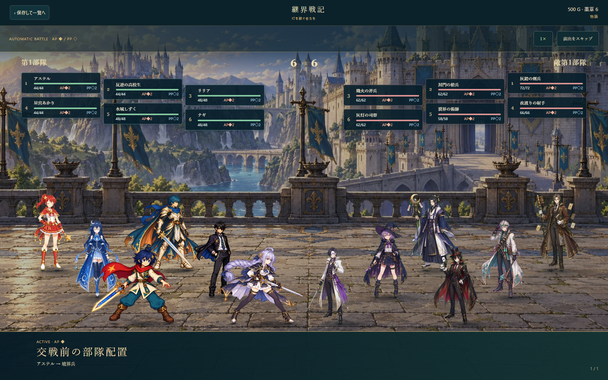
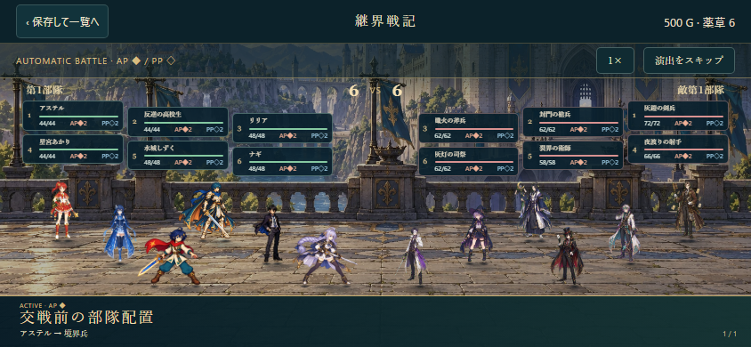
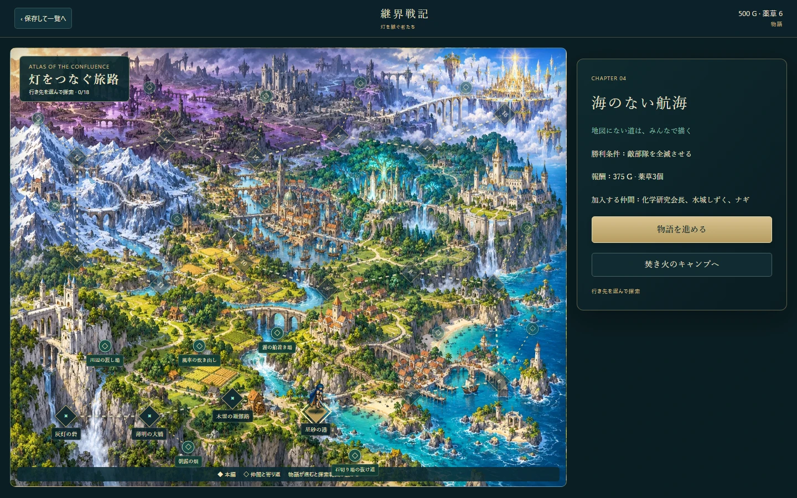
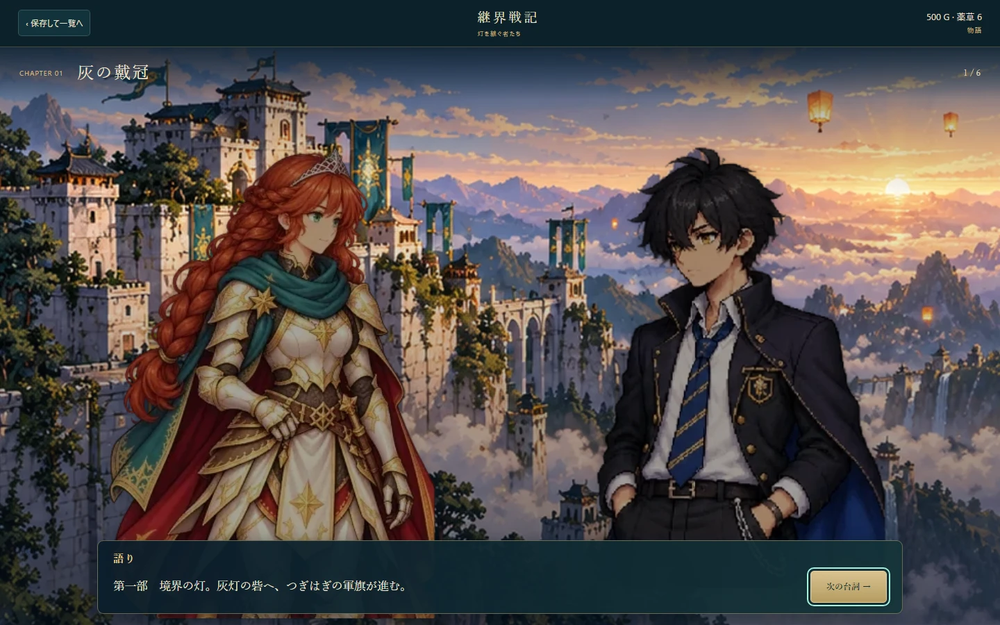

# 継界戦記 ― 灯を継ぐ者たち

ミニゲーム一覧に追加した、学習ローグの世界を横断する独立したSRPG。通常の一覧では学習正解数4000で開放。音声の生成・組み込みは今回行っていない。

## 遊び方と収録内容

- 本編18章、地形の異なる18戦場、6つの任意遊撃戦、2種類のエピローグ。
- 男性主人公アステル／女性主人公リュラを選択。選択した主人公を含め39人が加入可能（高校編9、マジック編17、ダンジョンズ2の9、星潮の航路のナギ・ミオ・セナ）。
- 世界地図→会話→戦場→戦後会話→世界地図の循環。キャンプでは3部隊の前後列編成、作戦の優先順位・発動条件・対象、訓練、武器強化、記録を利用できる。
- 12組×3段階の支援会話。同じ部隊での交戦で絆が成長し、条件を満たすと支援会話と攻撃補正を利用できる。
- 部隊定員は第一部3人、第二部4人、第三部6人。六つの配置枠から前衛3・後衛3を自由に選択する。
- 部隊が同時に進軍する、いつでも一時停止可能な戦場。制圧・護衛・防衛・脱出・敵将撃破・全滅で目標が変わる。本拠点喪失、時間切れ、全味方戦闘不能、護衛対象喪失が敗北条件。
- 接敵で時間停止。予測を確認して交戦または退避。交戦は速度順にAP／PPと条件付き作戦で自動進行する。近接は前衛を優先し、弓・魔法は後衛を狙える。庇う、反撃、応急手当、氷縛、炎の継続ダメージを収録。
- 近くの弓・魔法・杖部隊による援護、交戦後のスタミナ、無防備になる休息、拠点駐留、ブレイブによる回復・進軍補助、増援、物資庫。
- 予測と実戦は同じ決定的なリゾルバーを使う。AP消費または全滅で交戦が終わり、残HPの割合で部隊の勝敗と後退を判定する。
- 行動後の自動保存。復帰時は戦場を一時停止。出撃時のチェックポイントから再挑戦可能。敗北で仲間は永久離脱しない。
- 新規開始で保存を置き換える際にはゲーム内で確認する。他のモードの保存領域は使用しない。

## 素材と演出

戦闘用イラストとマップ用の方向別イラストを分けている。高校・マジックの戦闘には学習ローグ本編の既存待機／攻撃／被弾／スキル用4コマシートを使用。マップ表示はダンジョンズの方向別素材を使用。会話には既存のイベント用反応立ち絵を使用する。新主人公の男女には通常・喜び・不安・決意の会話専用立ち絵を各4枚制作し、戦闘イラストとは分けて表示する。

ダンジョンズ2は9人全員に6つの戦闘姿勢を新規生成。星潮の3人には各6戦闘姿勢と4方向×3移動姿勢を新規生成。オリジナル主人公には各8枚の独立した戦闘イラストと4方向×3移動姿勢を用意。単独画像で生成し、余白と切り出し枠で隣のポーズの混入を防止する。必殺には専用イラストのカットイン、攻撃・被弾・数値演出を使用。待機時の呼吸と重心移動に加え、本編キャラクターの待機シートで髪・衣服・仕草の差分を再生する。動きを減らすOS設定に対応する。

ImageGenで会話用背景4枚、戦闘用背景6枚、世界地図、4地方×16種の地形テクスチャと16種類の建築・植物・岩のマップ素材を制作。進軍マップは地形・道・岸辺・建築・植生を重ねて描画する。UIは生成画像を使用せず、HTML/CSSで画面サイズと文字量に合わせて配置する。生成時のプロンプト・元PNG・パッキング情報は assets/lantern-war/ 内。実行時は public/sprites/lantern-war/ の圧縮WebPを使用し、生成サービスへの接続は不要。UIの文字と数値はHTMLで描画し、ボタンと地図はタッチ・キーボード双方で操作する。

## 構成

- src/mini-games/lantern-war/engine.ts: キャンペーン・進軍・保存・目標判定
- combat.ts: 前後列、条件付き作戦、AP/PPと交戦予測
- story.ts / roster.ts: 全章・加入・支援・キャラクター固有設定
- Battlefield.tsx: 指揮マップ、戦闘予測、戦闘演出
- CampaignViews.tsx / LanternWar.tsx: 世界地図、キャンプ、会話、エンディング
- art.tsx / battleSources.ts: 用途別アート参照と待機アニメーション
- GroundedArmy.tsx / battleMetrics.json: 全46人分の画像内の足元・余白情報を使う、接地・向き・隊列の描画。各人のパラメータは画面上部の左右パネルに分離し、隊列に合わせた縦2段×横3枚の斜め配置。靴の接地点ごとの接地影、柔らかい周辺影、短い落ち影を重ねる
- scripts/normalize-lantern-war-battle.mjs: 1104アクションフレームの座標確認と一覧画像の生成
- copy.ts: 共通UIの英語・ひらがな対応

音声追加時は、章番号・intro/outro・台詞番号、および支援番号・ランク・台詞番号をIDとして利用できる。既存のAGENTS.mdに従い、実際の音声生成は最新版Irodori-TTSをCPUで実施する。

## 検証

6対6の実画面（上部パラメータ・斜め隊列・接地影）:

pnpm run test:lantern-war
pnpm run test:lantern-war:browser
pnpm run audit:english:gate
pnpm run build
pnpm run server:build

ルールテストでは男女双方の全18章を、実際の移動・休息・予測・交戦APIを使うコマンドボットで通す。ブラウザーテストではタイトル、主人公選択、世界地図、会話、編成、作戦、移動、一時停止、予測、戦闘、再開、エンディングとPC／縦横スマホの画面を確認する。

参考にした戦闘の説明：
- https://appmedia.jp/uol
- https://unicorn-overlord.com/system/stage-battle/

物語・登場人物・UI素材・演出は本プロジェクトの独自制作と既存資産を用いている。

部隊交戦の終了ごとに共通の学習画面で3問出題する。選択した教科・回答方法・課題を引き継ぎ、学習後は戦場を一時停止して再開する。未完了の学習は保存され、再起動後も先に出題する。攻撃には斬撃・衝撃波・魔法光輪を表示し、固有必殺技のカットインと組み合わせる。

会話・編成・主人公選択のプレビューは静止表示。会話カードは画面下の小さなパネルに収め、立ち絵は背景上で大きく表示する。

専用の彩色フィールドマップ上で主人公が街道を移動する。本編18地点は到達章まで自由に再訪でき、進行に応じて18件の選択付き寄り道が開放される。救護・炊き出し・避難・修理・記録などの小話を通じ、既存主人公18人を本編の合流より早く迎えることができる。既に加入済みなら交流と補給の物語になる。報酬と選択は保存され、再読で重複獲得しない。
会話画像は全40人×4表情を共通の頭部スケールと上端位置へ正規化し、人物サイズの差を解消。専用地図は生成元も配信用もWebPを使用する。

通常体格の人物は画面上部の共通アンカーに頭を揃え、下部を画面外へ逃がして大きく表示する。小柄な星潮の3人には低いアンカーを使用する。

